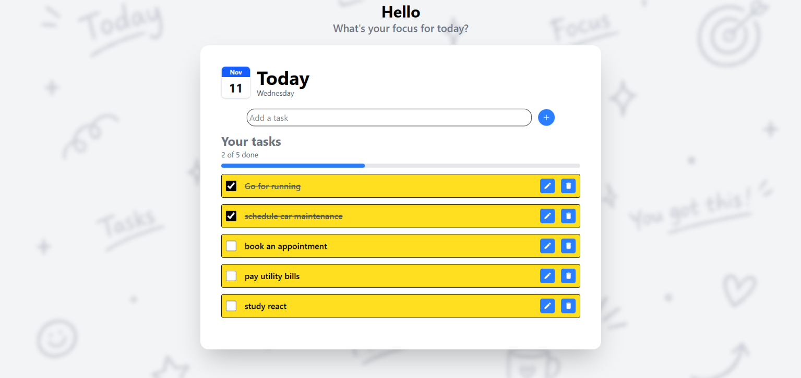

# To-Do App

A to-do app built with React and Vite.

## Screenshots

## Features
- Add, complete, and delete tasks
- Built with React components and hooks

## Built with
- React
- Vite

## Run it locally
1. Clone the repo:
   `git clone https://github.com/krishvermaxd-spec/todo-app.git`
2. Install dependencies:
   `npm install`
3. Start the dev server:
   `npm run dev`